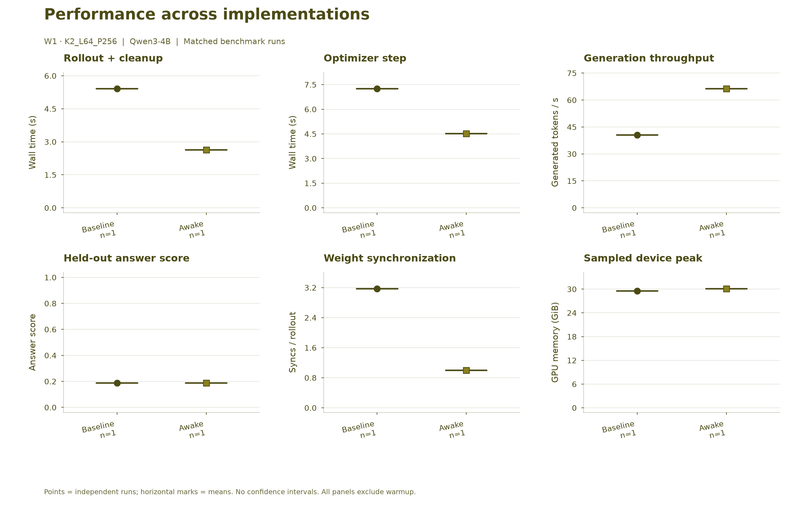
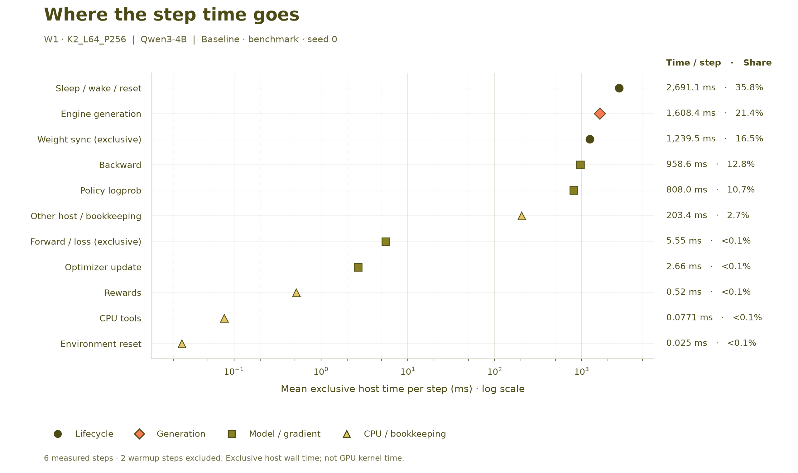
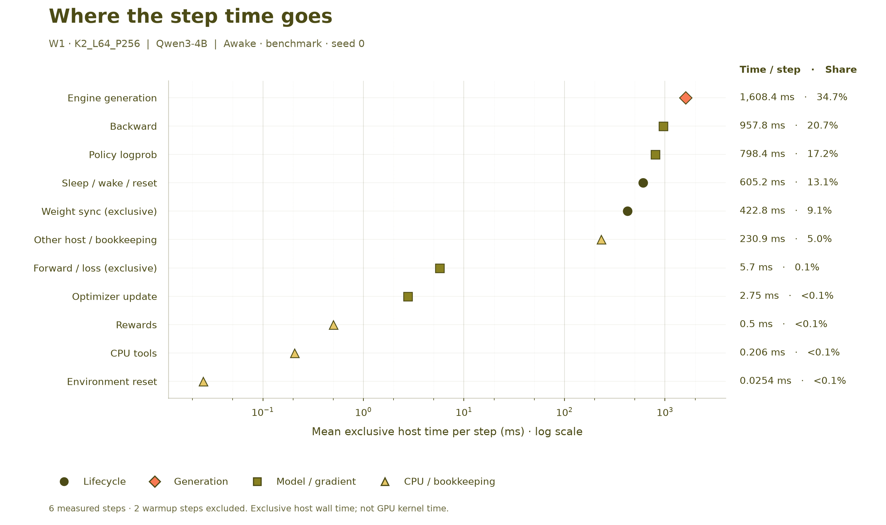
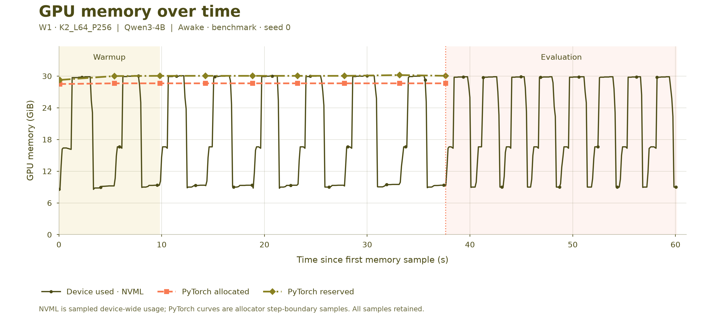
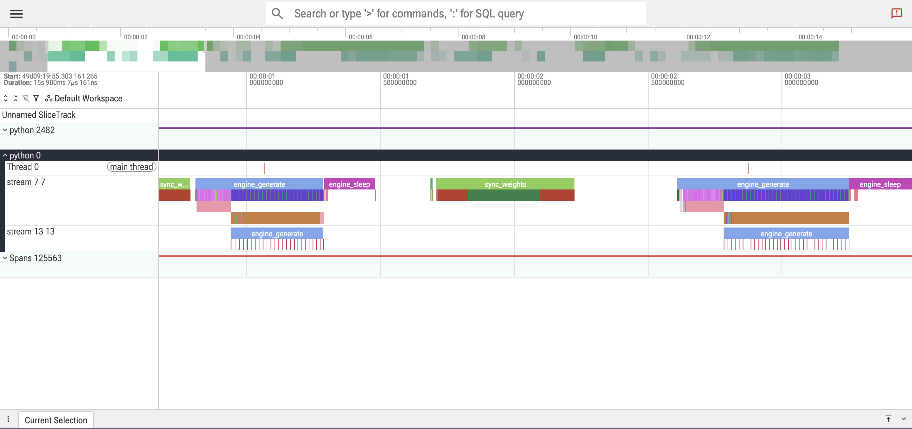
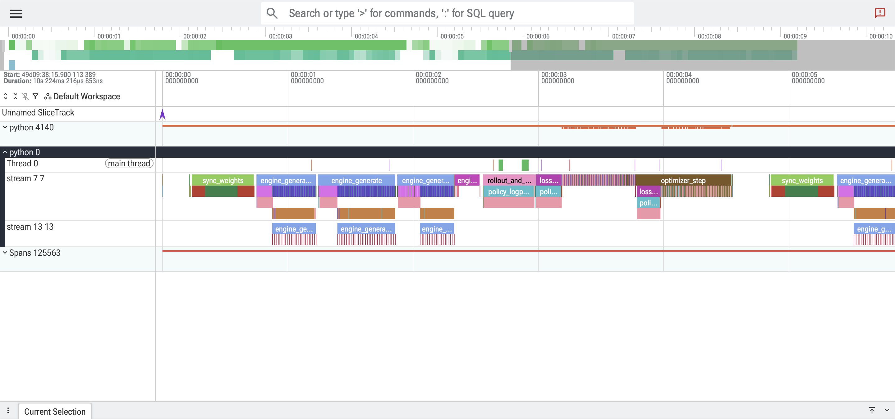
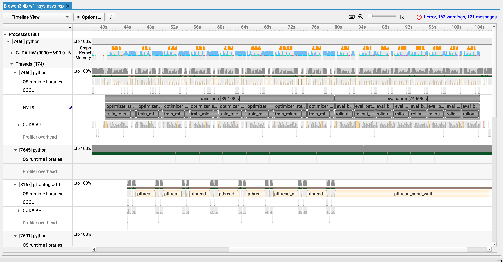

# GRPO profiling and evaluation

This harness measures the real tool-calling GRPO workload: rollout and optimizer-step latency, generated-token throughput, GPU memory, and task quality. It also exports PyTorch traces for Perfetto and NVTX ranges for Nsight Systems.

The results below use **Qwen3-4B on W1/K2_L64_P256**.

## 1. What runs and where the code lives

A training step generates several trajectories, executes the requested tools, scores the answers, and updates the model with GRPO. A trajectory is one prompt's complete conversation, including tool calls.

```text
saved prompts → vLLM generation → tool call → next generation → final answer
             → rewards and policy log-probabilities → backward → optimizer update
training ends → evaluation on 16 separate held-out prompts → metrics and plots
```

| File | Role |
|---|---|
| [`run.py`](run.py) | CLI, configuration, GRPO trainer, training and held-out evaluation |
| [`workloads.py`](workloads.py) | Reuse saved datasets, tools and rewards; create the train/holdout split; record task quality |
| [`instrumentation.py`](instrumentation.py) | Time generation, weight sync, wake/sleep, tools, scoring and training |
| [`recorder.py`](recorder.py) | Write nested events and calculate exclusive host time |
| [`capture.py`](capture.py) | PyTorch Profiler, NVTX ranges, CUDA events and allocator samples |
| [`memory.py`](memory.py) | Sample device memory through NVML every 100 ms |
| [`summarize.py`](summarize.py) | Exclude warmup; produce summary metrics and CSV tables |
| [`plot.py`](plot.py) | Per-run figures, HTML report and matched-run comparison |
| [`configs/`](configs/) | Workload and experiment settings |
| [`prep.sh`](prep.sh) | Reuse environment setup and data generation |
| [`matrix.py`](matrix.py), [`smoke.py`](smoke.py), [`tests/`](tests/) | Experiment-grid configs and CPU checks; the CPU fixture is not a performance result |

The harness reuses the environment setup in `../linux/`, data generation and tool environments in `../data_prepare/`, and TRL's existing `GRPOTrainer` / `VLLMGeneration`. It measures the awake optimization in the checked-out TRL source.

| Workload | Task | Config |
|---|---|---|
| W1 | Follow an arithmetic chain with `get_op(op_id)` | `configs/smoke.json` |
| W2 | Follow links in a shared retrieval corpus with `search(query)` | `configs/w2.json` |
| W3 | Answer MuSiQue questions using a question-specific retrieval corpus | `configs/w3.json` |

For example, W1 may start at 5, return `+2` and then `−1` through two tool calls, and expect `<answer>6</answer>`. The smoke cell is `K2_L64_P256`: intended chain length 2, tool-response length 64 tokens, and prefix length 256 tokens under the data-generation tokenizer.

## 2. Run the harness

Run the following **Bash commands from the `trl/` repository root**. GPU runs require Linux and exactly one visible BF16-capable CUDA GPU.

### Environment and shared settings

For a **fresh machine**, run `bash HPML_WORK/profiling/prep.sh` once. It recreates the training environment and generates the data.

For an already prepared machine, activate the existing environment:

```bash
source .venv-issue7429/bin/activate
export HF_ENDPOINT=https://huggingface.co

CONFIG=HPML_WORK/profiling/configs/smoke.json
RUNS=HPML_WORK/profiling/runs
REV_06=c1899de289a04d12100db370d81485cdf75e47ca
REV_4B=1cfa9a7208912126459214e8b04321603b3df60c
SEED=0
```

Each output directory must be new. Model IDs download missing files into the Hugging Face cache; a complete local snapshot can replace the ID. Always pass the matching revision when changing models.

### Select A, B or C

| Stage | `--variant` | Required TRL source | Prefix cache |
|---|---|---|---|
| A | `baseline` | Sleep after every generation call | Off |
| B | `awake` | Stay awake across tool turns; sleep once after rollout | Off |
| C | `awake_cache` | Same awake implementation as B | On |

Select **one** setting before using any of the commands below:

```bash
# A: on baseline source
STAGE=A; VARIANT=baseline

# B: on awake source, use instead
# STAGE=B; VARIANT=awake

# C: on awake source, use instead
# STAGE=C; VARIANT=awake_cache
```

`--variant` does not install the optimization. After saving Stage A results, integrate the awake implementation into a clean checkout that contains this harness:

```bash
git cherry-pick 4b9eb201e2a9efa5e9749311d6aa8ec29d85b6cf
```

Skip that integration if it is already present. The runner rejects a variant that does not match the source lifecycle. The supplied A runs use baseline source; B uses the same awake patch in all three modes. Each run's `manifest.json` records its exact commit.

### Benchmark: latency, throughput, memory and quality

```bash
# Qwen3-0.6B
python -m HPML_WORK.profiling.run \
  --config "$CONFIG" --variant "$VARIANT" --seed "$SEED" \
  --model Qwen/Qwen3-0.6B --revision "$REV_06" \
  --vllm-gpu-memory-utilization 0.3 \
  --mode benchmark --plots \
  --output "$RUNS/${STAGE}-qwen3-0.6b-w1-s${SEED}"

# Qwen3-4B: settings used for the supplied benchmark results
python -m HPML_WORK.profiling.run \
  --config "$CONFIG" --variant "$VARIANT" --seed "$SEED" \
  --model Qwen/Qwen3-4B --revision "$REV_4B" \
  --vllm-gpu-memory-utilization 0.45 \
  --mode benchmark --plots \
  --output "$RUNS/${STAGE}-qwen3-4b-w1-s${SEED}"
```

Append `--dry-run` to either command to validate configuration without downloading a model or using the GPU. The default smoke run performs 8 optimizer steps, excludes the first 2 from performance summaries, and evaluates 16 held-out prompts. It uses BF16, LoRA rank 8, gradient checkpointing, and non-thinking mode. Microbatch 2 × accumulation 2 gives 4 trajectories per rollout, with 2 completions per prompt.

### Profile: PyTorch Profiler and Perfetto

```bash
# Qwen3-0.6B
python -m HPML_WORK.profiling.run \
  --config "$CONFIG" --variant "$VARIANT" --seed "$SEED" \
  --model Qwen/Qwen3-0.6B --revision "$REV_06" \
  --vllm-gpu-memory-utilization 0.3 \
  --mode profile --cuda-events --plots \
  --output "$RUNS/${STAGE}-qwen3-0.6b-w1-profile"

# Qwen3-4B
python -m HPML_WORK.profiling.run \
  --config "$CONFIG" --variant "$VARIANT" --seed "$SEED" \
  --model Qwen/Qwen3-4B --revision "$REV_4B" \
  --vllm-gpu-memory-utilization 0.45 \
  --mode profile --cuda-events --plots \
  --output "$RUNS/${STAGE}-qwen3-4b-w1-profile"
```

The default schedule captures optimizer steps **5 and 6**. Open `traces/train-step-6.json` in [Perfetto](https://ui.perfetto.dev), then inspect `optimizer_step`, `sync_weights`, `engine_generate`, `engine_wake`, `engine_sleep`, and the GPU kernel tracks. Use this mode to explain where time goes; use benchmark mode for speedup numbers.

### Nsight: CUDA, memory copies and NVTX

Nsight Systems must be installed separately; the personal guide contains an installation reference.

```bash
mkdir -p "$RUNS"

# Qwen3-0.6B
nsys profile --trace=cuda,nvtx,osrt --sample=none \
  --output="$RUNS/${STAGE}-qwen3-0.6b-w1-nsys" \
  python -m HPML_WORK.profiling.run \
    --config "$CONFIG" --variant "$VARIANT" --seed "$SEED" \
    --model Qwen/Qwen3-0.6B --revision "$REV_06" \
    --vllm-gpu-memory-utilization 0.3 \
    --mode nsight --plots \
    --output "$RUNS/${STAGE}-qwen3-0.6b-w1-nsys-data"

# Qwen3-4B
nsys profile --trace=cuda,nvtx,osrt --sample=none \
  --output="$RUNS/${STAGE}-qwen3-4b-w1-nsys" \
  python -m HPML_WORK.profiling.run \
    --config "$CONFIG" --variant "$VARIANT" --seed "$SEED" \
    --model Qwen/Qwen3-4B --revision "$REV_4B" \
    --vllm-gpu-memory-utilization 0.45 \
    --mode nsight --plots \
    --output "$RUNS/${STAGE}-qwen3-4b-w1-nsys-data"

nsys stats "$RUNS/${STAGE}-qwen3-0.6b-w1-nsys.nsys-rep"
nsys stats "$RUNS/${STAGE}-qwen3-4b-w1-nsys.nsys-rep"
```

Run `nsys stats` for the model you captured. Open the `.nsys-rep` in Nsight Systems and zoom into one `optimizer_step` to inspect NVTX ranges, CUDA kernels, copies, and GPU idle gaps. `--mode nsight` alone emits labels; the outer `nsys profile` command records them. This capture includes startup and evaluation as well as training.

The supplied 4B runs use `vllm_gpu_memory_utilization=0.45` in all three modes. Compare A against B **within the same mode**, and use benchmark runs for performance claims because profiling adds overhead. On a different GPU, choose a memory budget that fits both the trainer and vLLM, then keep it fixed across variants.

### Other workloads and comparisons

The same two-model commands support W2 and W3: change `CONFIG` to `HPML_WORK/profiling/configs/w2.json` or `w3.json`, and change `w1` in output names accordingly. Use `--cell` to select another generated cell. Keep dataset, model, memory budget and batch settings fixed within each A/B/C comparison.

After collecting A and B benchmark runs, compare each model separately:

```bash
# Qwen3-0.6B
python -m HPML_WORK.profiling.plot \
  "$RUNS/A-qwen3-0.6b-w1-s0" "$RUNS/B-qwen3-0.6b-w1-s0" \
  --output-dir HPML_WORK/profiling/figures/reproduce-AB-qwen3-0.6b-w1

# Qwen3-4B
python -m HPML_WORK.profiling.plot \
  "$RUNS/A-qwen3-4b-w1-s0" "$RUNS/B-qwen3-4b-w1-s0" \
  --output-dir HPML_WORK/profiling/figures/reproduce-AB-qwen3-4b-w1
```

Add the matching C directory when available. The comparison checks settings and excludes profile/Nsight runs. It writes `comparison.png`, `comparison.svg`, `comparison.csv`, and `paired-speedups.csv`.

## 3. Read a run

Start with `report.html`, then check `summary.json` for exact values. `manifest.json` records the status, settings and machine.

| Mode | Key outputs | What to look for |
|---|---|---|
| `benchmark` | `summary.json`, `steps.csv`, `rollouts.csv` | Step/rollout latency, tokens/s, sync and sleep counts |
| `profile` | `traces/train-step-6.json`, `*-cpu.txt`, `*-cuda.txt`, `*-operators.csv` | CPU/GPU timeline, operator costs and call counts |
| `nsight` | Sibling `.nsys-rep`; optional exported `.sqlite`; run directory `*-nsys-data/` | CUDA/NVTX timeline, kernels and memory copies |
| All modes | `memory.csv`, `allocator_memory.csv`, `figures/memory.png` | Device memory over time and PyTorch allocation samples |
| All modes | `quality.csv`, `eval-trainer-metrics.json`, `demo-trajectories.json` | Answer scores, actual tool calls, and example interactions |
| All modes | `events.jsonl`, `trainer-logs.csv` | Raw phase timings and training logs when investigating a result |

The five per-run figures are `performance`, `breakdown`, `timeline`, `memory`, and `quality`, in both PNG and SVG. `timeline` shows the host phases of a measured step; the Perfetto and Nsight traces provide the detailed CPU/GPU view.

Important metric definitions:

- **Step latency** includes rollout, scoring, accumulated training microbatches and optimizer update, with CUDA synchronization at its boundaries.
- **Rollout latency** includes the final sleep cleanup in both A and B, even though B moves it outside `_generate`.
- **Tokens/s** = generated tokens / measured step seconds. Prompt and tool-response tokens are excluded.
- **Time breakdown** uses exclusive host time, so nested phases are not counted twice. Generation combines prefill and decode.
- **Memory**: NVML is sampled device-wide occupancy; PyTorch curves are step-boundary allocated/reserved values. Allocator peaks are also saved in the summary. The curves have different scopes and sampling times.
- **Quality**: training answer scores and held-out answer scores are separate. The full-chain rate checks whether required tools were followed; it does not mean the arithmetic answer was correct.

## 4. Current W1 results and figure examples

### Environment

Each of the six supplied runs uses **Qwen3-4B** and one **NVIDIA RTX A6000 (~48 GiB)**, with Linux, Python 3.12.3, CUDA 13.0, PyTorch 2.13.0, vLLM 0.32.0, and Transformers 5.19.0. All use W1 `K2_L64_P256`, seed 0, 8 steps with 2 warmup steps, a 16-prompt holdout, and a **vLLM memory fraction of 0.45**. Model revision, dataset, split and harness match across modes. Benchmark/profile share one physical GPU; the Nsight A/B pair shares another A6000.

### Benchmark comparison

Values below cover the six measured steps.

| Metric | A: baseline | B: awake |
|---|---:|---:|
| Median optimizer step | 7.242 s | 4.508 s |
| Median rollout + cleanup | 5.406 s | 2.639 s |
| Generated tokens/s | 40.59 | 66.23 |
| Generated tokens | 1,831 | 1,841 |
| Generation calls | 19 | 19 |
| Weight sync / wake / sleep calls | 19 / 38 / 19 | 6 / 12 / 6 |
| NVML sampled peak | 29.55 GiB | 30.06 GiB |
| Training full-chain rate / tool errors | 100% / 0 | 100% / 0 |
| Held-out correct answers | 3 / 16 | 3 / 16 |

B has **1.61× faster median steps**, **2.05× faster median rollouts**, and **1.63× higher token throughput**. Generation work is similar; repeated weight sync and wake/sleep account for the main reduction. The sampled memory peak increases slightly rather than decreasing.

Raw events reproduce the saved summaries, and every measured rollout matches its expected lifecycle. This is one seed with six measured steps, so these are pilot results. Tokens differ by 0.55%; this is not a fixed-token replay or evidence of improved answer quality.



The comparison figure shows performance, task score, sync frequency and device peak together. Each point is one run; there are no confidence intervals.

### Time breakdown

| A: baseline | B: awake |
|---|---|
|  |  |

Mean exclusive generation time is about **1.608 s/step in both runs**. Combined sync, wake and sleep time falls from **3.929 to 1.028 s/step**. These are host phase times; inspect CUDA tracks for kernel-level attribution.

### Memory during an awake rollout



Device memory rises while vLLM is awake and drops after the rollout. NVML tracks physical device occupancy; the PyTorch lines track allocator records at step boundaries. With vLLM sleep mode, those allocator records can remain high after physical memory is released.

### Perfetto: where the repeated work disappears

A — baseline:



B — awake:



Across the two captured steps, A has six sync/sleep cycles and B has two, while both have six generation calls. The screenshots use different zoom scales; read their labels and nesting rather than comparing pixel widths. These diagnostic runs also show slow wake/sleep phases after capture; their aggregate latencies are not benchmark numbers.

### Nsight: confirm the lifecycle on CUDA tracks

Open `runs/*.nsys-rep` in Nsight Systems; contain CUDA kernels, memory copies and the harness's NVTX ranges. Counts below cover the **whole captured job**, including warmup and evaluation:

| NVTX range | A: baseline | B: awake |
|---|---:|---:|
| Generation | 49 | 49 |
| Weight sync | 49 | 16 |
| Engine wake | 98 | 32 |
| Engine sleep | 49 | 16 |

The NVTX counts match `events.jsonl`. Restricting to the six measured training steps gives 19 generation calls in both runs and 19 versus 6 sync/sleep calls, consistent with the benchmark mechanism.

A - Baseline


B - Awake

