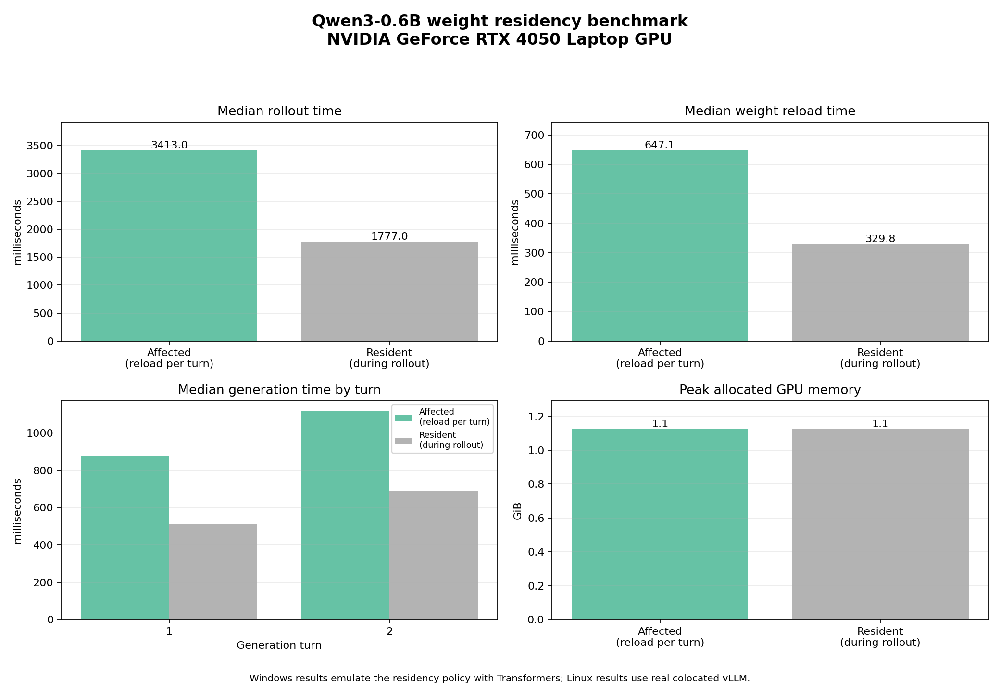

# Windows GPU benchmark: issue #7428 / PR #7429

GitHub #7428 is the performance issue; #7429 is the proposed fix. Native Windows does not support vLLM, so this benchmark uses the real Qwen3-0.6B model and CUDA through Transformers to measure GPU weight offload/reload costs. It emulates the residency lifecycle but **does not execute vLLM or prove the TRL/vLLM bug itself**. Use the [Linux vLLM benchmark](../../linux/docs/ISSUE_7429_BENCHMARK.md) for that.

## Setup

Run from the repository root in PowerShell:

```powershell
powershell -ExecutionPolicy Bypass -File HPML_WORK\windows\scripts\setup_issue7429_windows.ps1
```

The setup creates `.venv-issue7429`, installs CUDA-enabled PyTorch, this TRL checkout with PEFT and visualization dependencies, and downloads the pinned model into the repository-relative `models\Qwen3-0.6B` directory.

## Run on the local GPU

```powershell
.\.venv-issue7429\Scripts\Activate.ps1
python HPML_WORK\windows\scripts\issue7429_windows_gpu_benchmark.py `
  --turns 2 --iterations 3 --max-new-tokens 12 --dtype float16
```

All documented paths are relative to the repository root. By default, the benchmark reads `models\Qwen3-0.6B` and saves JSON to `HPML_WORK\windows\results\windows_gpu_benchmark_results.json`. Both paths accept relative overrides through `--model` and `--output`.

The script warms up both policies, then alternates them for each measured iteration. For two turns, the affected emulation offloads/reloads weights after each turn; the resident policy performs one initial load and offloads after the rollout. Both use the same deterministic prompt and CPU tool-result string.

## Visualize results

```powershell
python HPML_WORK\shared\scripts\visualize_benchmark.py
```

This writes `windows_gpu_benchmark_results_visualization.png` next to the JSON file. The plot compares median rollout latency, weight reload time, generation time per turn, and peak allocated VRAM.



To compare saved Linux baseline/fixed JSON files, pass both explicitly:

```powershell
python HPML_WORK\shared\scripts\visualize_benchmark.py `
  --input HPML_WORK\linux\results\baseline.json HPML_WORK\linux\results\fixed.json `
  --output HPML_WORK\linux\results\comparison.png
```

## Local RTX 4050 run

The local run used Qwen3-0.6B FP16, 2 turns, 12 max new tokens, one warm-up per policy, and 3 measured iterations. It generated matching token counts (9 and 12) under both policies.

| Emulated policy | Weight reloads | Inter-turn sleeps | Median rollout | Median weight-transfer time | Peak allocated VRAM |
|---|---:|---:|---:|---:|---:|
| Reload every turn | 2 | 1 | 3413 ms | 647 ms | 1.126 GiB |
| Keep resident in rollout | 1 | 0 | 1777 ms | 330 ms | 1.126 GiB |

These are local measurements of real GPU inference and CPU/GPU weight transfers, not vLLM timings. Run-to-run latency varied substantially (one affected-policy sample was 12.6 s), so treat these short-run medians as indicative only. Raw results are in [`../results/windows_gpu_benchmark_results.json`](../results/windows_gpu_benchmark_results.json), and the visualization is in [`../results/windows_gpu_benchmark_results_visualization.png`](../results/windows_gpu_benchmark_results_visualization.png).
